<p align="center">
  
</p>

<p align="center">
  <a href="https://www.anypayx.com"></a>
  <a href="https://www.npmjs.com/package/anypay-prices"></a>
  <a href="https://github.com/anypay/prices-ts/blob/main/LICENSE"></a>
  <a href="https://github.com/anypay/prices-ts"></a>
</p>

<p align="center">
  <a href="https://www.anypayx.com">Website</a> ·
  <a href="https://www.anypayx.com/docs">Docs</a> ·
  <a href="https://api.anypayx.com/api">API</a> ·
  <a href="https://www.anypayx.com/prices">Price Feed</a> ·
  <a href="https://github.com/anypay">GitHub</a>
</p>

---

## What It Is & Purpose

**Anypay Prices (TypeScript)** is the real-time cryptocurrency and fiat price feed service that powers invoice calculations across the Anypay payment platform. When a merchant creates an invoice denominated in USD but accepts Bitcoin, Ethereum, or stablecoins, this service delivers the exchange rates that make instant, accurate conversions possible.

Built in TypeScript with Hapi.js, it aggregates price data from multiple trusted market sources—CoinMarketCap, Kraken, and Fixer.io—stores them in a Prisma-managed database with caching, and exposes both a REST API and a WebSocket API for real-time price subscriptions. The service runs as a standalone microservice and publishes price updates over RabbitMQ (AMQP) so the main Anypay invoice API and WalletBot can react immediately to market movements.

This is the production price oracle for Anypay: every invoice calculation, every on-chain payment verification, and every stablecoin conversion depends on the rates this service provides.

---

## Why Use It

**Anypay Prices** solves the volatility challenge in cryptocurrency payments by delivering live, multi-source exchange rates that keep invoices accurate to the second.

- **Who it's for:** Developers building on Anypay who need programmatic access to the same price feeds the platform uses internally, or operators running self-hosted Anypay infrastructure who want to run their own price aggregation layer.
- **Where it fits:** Sits between external market data providers (CoinMarketCap, Kraken, Fixer.io) and the Anypay invoice/payment system. Invoices call the REST conversion endpoint; WalletBot subscribes to the WebSocket feed; and both rely on this service's cached, normalized price records for sub-second quote delivery.

**Key advantages:**

- **Multi-source aggregation** — pulls crypto prices from CoinMarketCap and Kraken, and fiat rates from Fixer.io, so no single source failure breaks the platform
- **Real-time & cached** — cron jobs refresh crypto prices every minute and fiat every hour, with Prisma/Postgres caching ensuring fast lookups even under invoice bursts
- **WebSocket subscriptions** — clients can subscribe to live price streams without polling, reducing latency for dynamic checkout UIs
- **AMQP/RabbitMQ integration** — publishes price updates to `anypay.prices` exchange so services across the stack react to new rates immediately
- **Self-contained TypeScript stack** — runs independently with `ts-node`, packages as a standalone binary with `pkg`, and ships the same DB schema migrations the main platform uses

---

## How It Works

<p align="center">
  
</p>

The price service operates as a four-stage pipeline:

1. **Market Feeds** — Scheduled cron jobs (`src/cron.ts`) poll CoinMarketCap and Kraken APIs for cryptocurrency prices (every 1 minute) and Fixer.io for fiat exchange rates (every 60 minutes). Each provider module (`src/coinmarketcap.ts`, `src/kraken.ts`, `src/fixer.ts`) returns normalized price objects with `base`, `quote`, `value`, and `source` fields.

2. **Price Aggregator** — Incoming prices are written to the Prisma-managed PostgreSQL database (`src/prisma.ts`, `@prisma/client`). The database stores historical price records indexed by `base`, `quote`, and `source`, enabling point-in-time lookups and multi-source fallback. AMQP messages are published to the `anypay.prices` RabbitMQ exchange (`src/amqp.ts`) whenever prices update, so subscribers across the platform see changes without polling.

3. **API & WebSocket** — Two interfaces expose the price data:
   - **REST API** (Hapi.js, `src/server.ts`): `GET /api/prices/{base}/{quote}/{source}` retrieves a single cached price; `POST /api/conversions` performs a currency conversion by looking up the exchange rate and multiplying; `GET /api/sources` lists available price sources.
   - **WebSocket API** (`src/server/websockets/server.ts`): Clients connect via `ws://` and send JSON-RPC-style messages (`getPrice`, `listPrices`, `subscribe`, `updatePrice`) to stream live price updates. Each WebSocket session (`src/server/websockets/session.ts`) holds an AMQP channel and routes subscriptions through handlers in `src/server/websockets/handlers/`.

4. **Anypay Invoices** — The main Anypay invoice service (`@anypay/server`) calls the `/api/conversions` endpoint to price invoices at creation time (e.g., "charge $50 USD in BTC") and subscribes to the WebSocket feed to re-price open invoices if the exchange rate moves before payment arrives. WalletBot listens to the same feed to know how much BTC to send when settling an invoice on-chain.

Environment variables control the service's HTTP (`PRICES_HTTP_HOST`, `PRICES_HTTP_PORT`) and WebSocket (`PRICES_WEBSOCKET_HOST`, `PRICES_WEBSOCKET_PORT`) bind addresses, plus the AMQP exchange name (`PRICES_AMQP_EXCHANGE`).

---

## Quickstart / How to Use It

> Commands verified from `package.json`, `src/main.ts`, and actual repository state.

### Prerequisites

- **Node.js** 16+ and **npm** or **yarn**
- **PostgreSQL** database (Prisma-managed schema)
- **RabbitMQ** server (for AMQP messaging)
- **API keys**:
  - `COINMARKETCAP_API_KEY` (from [CoinMarketCap Pro API](https://pro.coinmarketcap.com/))
  - `KRAKEN_API_KEY` (optional, Kraken is used without auth for public ticker data in this codebase)
  - `FIXER_API_KEY` (from [Fixer.io](https://fixer.io/))

### Installation

```bash
# Clone the repository
git clone https://github.com/anypay/prices-ts.git
cd prices-ts

# Install dependencies
npm install

# Set up environment variables
cp .env.example .env
# Edit .env to add your API keys and database connection string
```

### Database Setup

```bash
# Run Prisma migrations to create the price tables
npx prisma migrate deploy

# (Optional) Generate Prisma client if not already built
npx prisma generate
```

### Running the Service

```bash
# Start the price service (HTTP + WebSocket + cron jobs)
npm start
```

By default, the service starts:

- **HTTP API** on `http://0.0.0.0:5200`
- **WebSocket API** on `ws://0.0.0.0:5210`

### Example REST API Usage

```bash
# Get the current Bitcoin price in USD from CoinMarketCap
curl http://localhost:5200/api/prices/BTC/USD/coinmarketcap

# Convert 100 USD to Bitcoin
curl -X POST http://localhost:5200/api/conversions \
  -H "Content-Type: application/json" \
  -d '{
    "base": {
      "value": 100,
      "currency": "USD",
      "source": "default"
    },
    "quote": {
      "currency": "BTC"
    }
  }'

# List all available price sources
curl http://localhost:5200/api/sources
```

### Example WebSocket Client

```typescript
import WebSocket from 'ws';

const ws = new WebSocket('ws://localhost:5210');

ws.on('open', () => {
  // Subscribe to Bitcoin price updates
  ws.send(JSON.stringify({
    method: 'subscribe',
    params: {
      base: 'BTC',
      quote: 'USD',
      source: 'coinmarketcap'
    }
  }));
});

ws.on('message', (data) => {
  const price = JSON.parse(data.toString());
  console.log('New BTC price:', price);
});
```

A CLI subscription demo is included at `src/bin/websocket_subscribe.ts`.

### Running Tests

```bash
npm test
```

---

## Next Moves for Growth

High-leverage improvements grounded in the current state of `prices-ts`:

1. **Add health check endpoint** — `/api/health` returning service status, last price update timestamp per source, and AMQP connection state. The Hapi server has no readiness probe right now; operators running this in Kubernetes or behind a load balancer need a way to verify the service is functional.

2. **Publish to npm as `@anypay/prices`** — `package.json` lists `"name": "anypay-prices"` but the package is not published. Publishing it as `@anypay/prices` with the TypeScript client interface (`src/client/index.ts`) would let external developers import the same price conversion logic Anypay uses internally, rather than calling the HTTP API.

3. **Document the WebSocket protocol** — `src/server/websockets/router/README.md` exists but is minimal. A full protocol spec (message formats, error codes, subscription lifecycle, `updatePrice` admin command) would help developers build robust WebSocket clients without reverse-engineering the handlers.

4. **Add Prometheus metrics** — Instrument request counts, conversion latencies, price staleness (time since last update per source), and AMQP publish failures. The main Anypay platform likely has a Prometheus scraper; exposing `/metrics` here would surface price service health in the same dashboards.

5. **Fallback logic when a source fails** — If CoinMarketCap returns a 429 or Kraken times out, the cron job logs an error but doesn't fall back to the other source. Add a fallback chain (try CoinMarketCap, then Kraken, then return stale cached price with a staleness flag) so invoice pricing never fails because one API is down.

6. **Automate the pkg build** — `package.json` declares `"pkg": { "targets": ["latest-macos-x64"], "outPath": "build/" }` but no `npm run build` script exists. Adding `"build": "pkg . --out-path build/"` and including a GitHub Actions workflow to publish the macOS binary on release would make self-hosted deployments one download away.

---

## Anypay Ecosystem & License

**Anypay Prices (TypeScript)** is part of [Anypay](https://www.anypayx.com) — Bitcoin & Stablecoin payments for business. Merchants and developers use Anypay to accept BTC, ETH, and stablecoins such as USDC, USDT, RLUSD, and NUSD through invoices, APIs, SDKs, webhooks, WooCommerce, and mobile POS.

| Project | Role |
| --- | --- |
| [anypay](https://github.com/anypay/anypay) | Invoice & payments platform / API (`@anypay/server`) |
| **[prices-ts](https://github.com/anypay/prices-ts)** | **Real-time crypto price feed & conversion service (this repo)** |
| [anypay-sdk](https://github.com/anypay/anypay-sdk) | TypeScript SDK for browser & Node.js (`@anypay/client`) |
| [walletbot](https://github.com/anypay/walletbot) | Self-custody headless wallet (`@anypay/walletbot`) |
| [web3-checkout-vite](https://github.com/anypay/web3-checkout-vite) | Current checkout UI (`checkout.anypayx.com`) |
| [anypayx.com](https://github.com/anypay/anypayx.com) | Marketing site, merchant dashboard, and developer docs |
| [merchant-app](https://github.com/anypay/merchant-app) | iOS & Android point-of-sale |

**License:** [ISC](LICENSE) — permissive open-source license. See `LICENSE` file in this repository for full text.

**Contributing:** This service is production infrastructure for Anypay. If you're running a self-hosted instance and discover a bug or performance issue, open an issue or submit a pull request. For security vulnerabilities, contact the Anypay team directly via [security@anypay.com](mailto:security@anypay.com) (if that address exists and is monitored) or through the [GitHub Security Advisories](https://github.com/anypay/prices-ts/security/advisories) page.

---

<p align="center">
  <a href="https://www.anypayx.com"></a><br/>
  <sub>Bitcoin & Stablecoin Payments For Business · <a href="https://www.anypayx.com">anypayx.com</a> · <a href="https://x.com/xanypay">@xanypay</a></sub>
</p>
